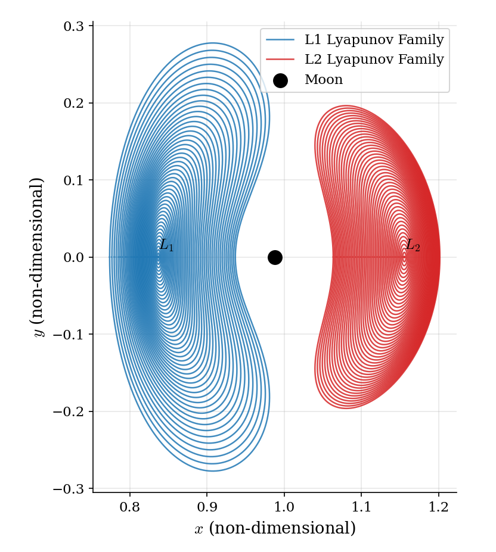
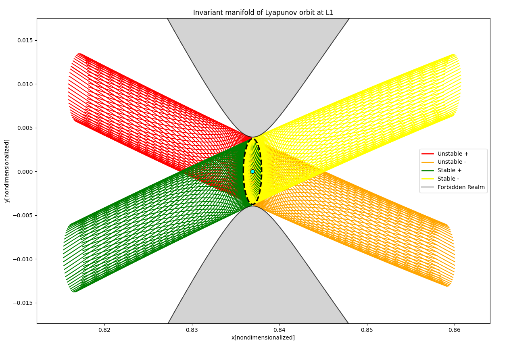
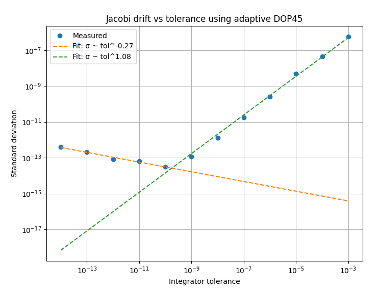
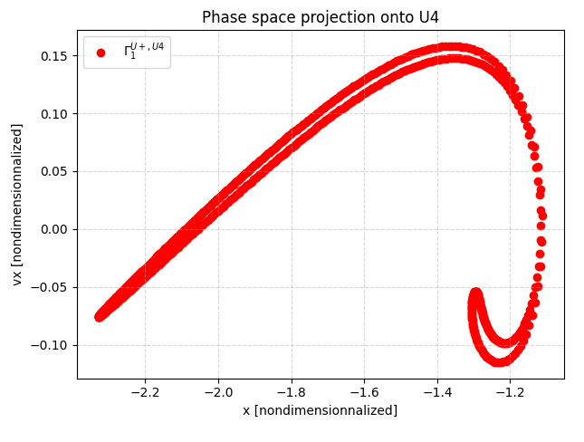
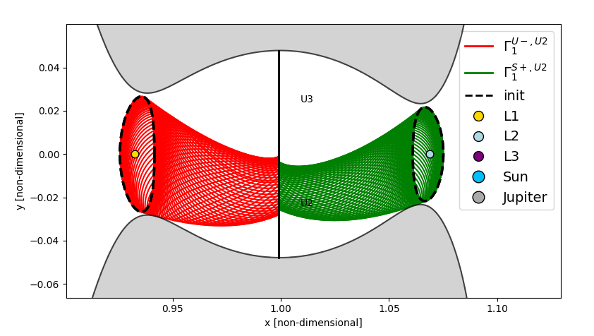
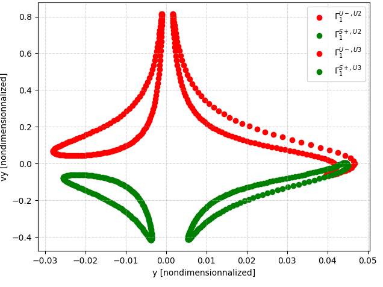

# CR3BP Manifold Explorer

Numerical toolkit to compute periodic orbits and invariant manifold structures in the planar Circular Restricted 
Three-Body Problem (CR3BP).

---

## Current State

The following capabilities are available for any mass parameter $\mu$:

- Compute collinear libration point positions ($L_1, L_2, L_3$).
- Compute planar Lyapunov orbit families for any energy between $L_1$ and $L_3$.
- Compute perturbation vectors from the monodromy matrix along periodic orbits.
- Propagate stable and unstable manifolds with event detection:
  - Maximum propagation time.
  - Impact on primary and secondary.
  - Intersection with target Poincare sections.
  - Realm path detection.
- Dense-output interpolation is used for every event detection, thus matching integrator precision. 
- Manifolds intersecting the same Poincare section are projected into phase space for hetero/homoclinic connection
exploration.
- Reproduce literature phase space projections using configuration files based on *Dynamical Systems, the Three-Body
Problem and Space Mission Design* by W. S. Koon, M. W. Lo, J. E. Marsden, and S. D. Ross (locally 
available via [docs/Ross_3BodyProblem_Book_2022.pdf](./docs/Ross_3BodyProblem_Book_2022.pdf)
).

---

## Method Overview

### 1. Planar Lyapunov Orbits
- Determination of libration points.
- Linearization of CR3BP dynamics at equilibrium points.
- Construction of initial guesses from linearized solutions.
- Differential correction to enforce symmetry conditions at half-period.
- Numerical integration using a fixed-step 4th-order Runge–Kutta (RK4) scheme.
- Automatic storing of Lyapunov seeds in a data directory for rapid downstream manifold computation.

### 2. Invariant Manifold Trajectories
- Extraction of monodromy matrix eigenvectors.
- Computation of stable/unstable perturbation vectors.
- Adaptive-step propagation using DOP45 with dense-output interpolation.

---

## Project Structure

```text
Repository
├── config/     # Configuration yaml files
├── src/        # CR3BP core physics and algorithms
├── graphic/    # Matplotlib scripts for data visualization
├── data/       # Stored data from previous runs
└── docs/       # Assets and reference literature
```
## Verification & Validation

To ensure high-precision reliability in chaotic three-body regimes, the pipeline features an automated V&V suite:
- **Jacobi Constant Invariance:** Each manifold strand can compute its jacobi mean and standard deviation along its
trajectory. 
- **Numerical Convergence Analysis:** Each manifold strand can compute its jacobi mean and standard deviation across its
integrator tolerance values from 1e-3 to 1e-14 empirically proving textbook algebraic truncation scaling and quantifying
the accumulated double-precision round-off floor
- **Symplectic Properties:** Validates monodromy matrix symplecticity to ensure mathematically consistent initial
perturbation vectors.
- **Mirror Symmetry Verification:** Validates time-reversed and space-mirrored propagation pairs ``[t, x, y, vx, vy] ``
to ``[-t, x, -y, -vx, vy]`` down to machine precision.

---

## Visualizations
<div align="center">
  
  <p><em>Figure 1: Planar Lyapunov family from L1 and L2.</em></p>
</div>

<div align="center">
  
  <p><em>Figure 2: Invariant manifold propagation from an L1 Lyapunov orbit.</em></p>
</div>

<div align="center">
  
  <p><em>Figure 3: Numerical convergence analysis showing truncation scaling and precision limits of a manifold strand 
from page73.yaml configuration.</em></p>
</div>

<div align="center">
  
  <p><em>Figure 4: Poincaré section phase-space projection from page73.yaml configuration file.</em></p>
</div>

<div align="center">
  
  <p><em>Figure 5: Unstable and stable manifold propagation (1st intersection with U2 only) from page76.yaml
configuration file.</em></p>
</div>

<div align="center">
  
  <p><em>Figure 6: Phase space projection of stable and unstable manifolds with their 1st intersection with U2 and U3 
from page76.yaml configuration file showcasing the existence of two heteroclinic connections between L1 and L2 
(the intersections between the two right side structures).</em></p>
</div>

## Installation and quick start

1. Clone the repository:
   ```bash
   git clone [https://github.com/aevrard-dev/cr3bp-manifold-explorer.git](https://github.com/aevrard-dev/cr3bp-manifold-explorer.git)
   cd cr3bp-manifold-explorer
   ```
2. Install requirements:
    ```bash
    pip install -r requirements.txt
    ```
3. Run default configuration file [config/page76.yaml](./config/page76.yaml) :

    ```bash
    python main.py
    ```
    or for a specific configuration file:
    ```bash
    python main.py --config path_to_configuration_file
    ```

## License & Citation

This project is distributed under the **MIT License**. See `LICENSE` for more details.

If you use this toolkit in your academic research or projects, please cite it as:
```bibtex
@software{cr3bp_manifold_explorer,
  author = {EVRARD Antonin},
  title = {CR3BP Manifold Explorer},
  year = {2026},
  url = {[https://github.com/aevrard-dev/cr3bp-manifold-explorer](https://github.com/aevrard-dev/cr3bp-manifold-explorer)}
}
```